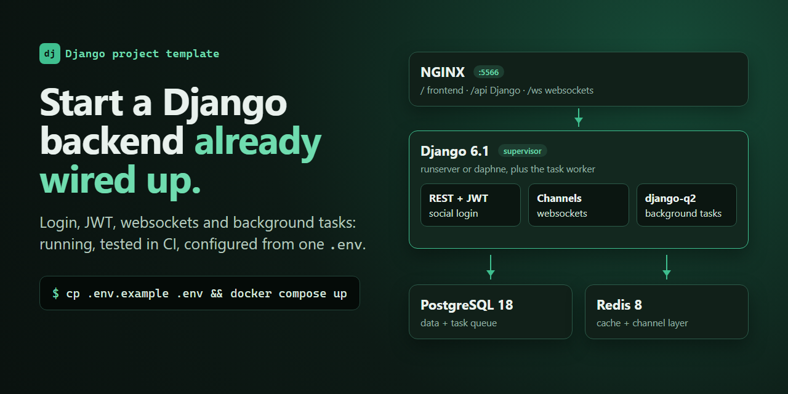
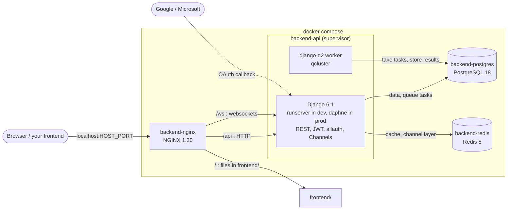
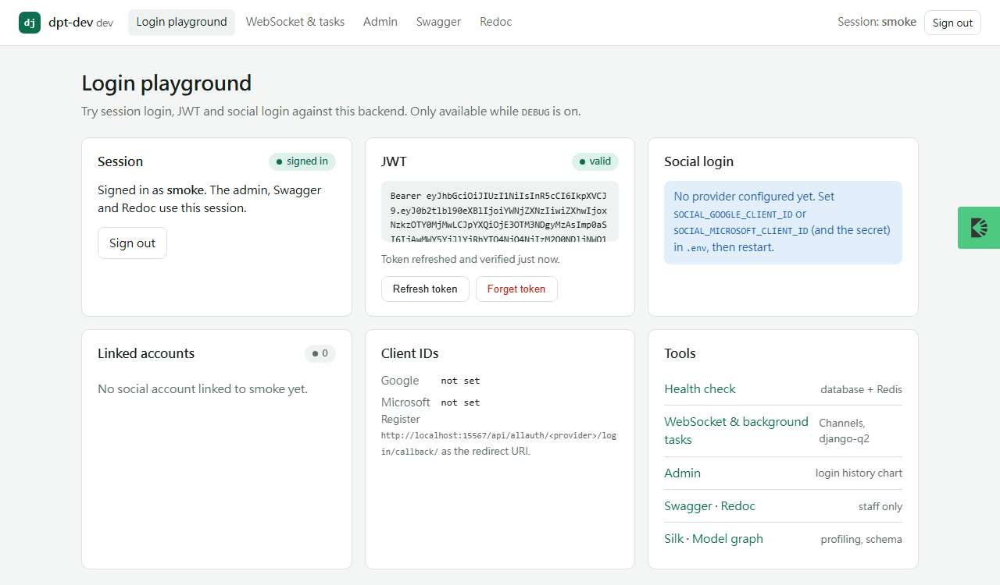
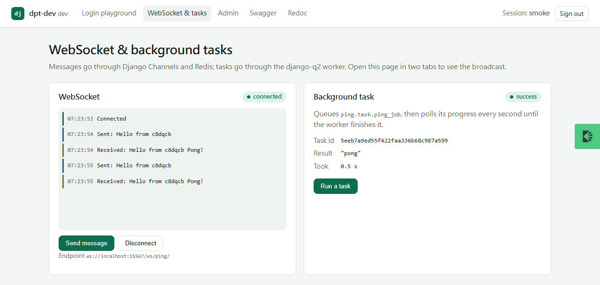

# Django Project Template



[](https://github.com/NatLee/django-project-template/actions/workflows/ci.yml)


A Django backend you can copy and start building on today. One `docker compose up` gives you PostgreSQL, Redis, NGINX and a Django app that already has JWT login, Google/Microsoft sign-in, websockets, background tasks, API docs and an admin with login history. Everything that changes between projects lives in `.env`, so starting a new project means copying the repo and editing one file. CI builds a fresh copy under a different name on every push and tests it end to end, so you know the template works before you use it.

## Quick start

You need Docker with Compose v2.

```bash
git clone https://github.com/NatLee/django-project-template.git my-project   # or "Use this template" on GitHub
cd my-project
cp .env.example .env              # set PROJECT_NAME and HOST_PORT if you like
docker compose up --build --wait  # a few minutes the first time
bash dev-tool.sh create-superuser
```

Then open:

| Page | URL |
|---|---|
| Your frontend (placeholder) | http://localhost:5566/ |
| Health check | http://localhost:5566/api/health |
| Login playground (session, JWT, social login) | http://localhost:5566/api/__hidden_dev_dashboard |
| WebSocket and background tasks demo | http://localhost:5566/api/ping/index |
| Admin | http://localhost:5566/api/__hidden_admin/ |
| Swagger / Redoc (staff only) | http://localhost:5566/api/__hidden_swagger · http://localhost:5566/api/__hidden_redoc |

The playground, the demo page, the admin and the debug tools exist only while `DEBUG=true`.

## What's inside



| Feature | Where | Notes |
|---|---|---|
| REST API with JWT | `custom_jwt/` | `POST /api/auth/token` returns `access_token`, `refresh_token`, `username`; refresh and verify endpoints too. Session auth works as well. |
| Social login → JWT | `authentication/` | Google and Microsoft through django-allauth. After the provider signs the user in, a small popup page turns the session into a JWT pair for your frontend (never in a URL). Email domain allow list, duplicate-email and "already linked" checks with friendly error pages, list/unlink linked accounts API. |
| Websockets | `ping/consumers.py` | Django Channels with a Redis channel layer; the ping consumer broadcasts to every connected client. |
| Background tasks | `ping/task.py`, `django_login_history/tasks.py` | django-q2 (the maintained fork of django-q) with the database as broker. Queue with `async_task(...)`, see results in the admin. |
| Admin | Django admin | Login history with a per-user chart, user profiles with change history (django-simple-history) and CSV/JSON/YAML import/export (django-import-export), task queue pages. |
| Login history | `django_login_history/` | Every login stores IP, browser and (in the background) country, region and city. |
| User profile | `userprofile/` | Created automatically for every user. |
| API proxy | `api_proxy/` | `/api/proxy/<path>` forwards an authenticated request to `{API_URL}api/<path>` and adds who asked. |
| API docs | drf-yasg | Swagger and Redoc, staff only. |
| Health check | `backend/health.py` | `GET /api/health` checks PostgreSQL and Redis; Compose waits on it. |
| Debug tools (DEBUG only) | settings | Debug Toolbar, Silk (`/api/silk/`), pyinstrument (`?profile`), cProfile middleware, model graph (`/api/__hidden_schema`). |
| Logs | `common/log.py` | Console plus hourly rotated files per category (`backend/logs/{file,database,api,auth}/`). |





## Starting your own project

1. Click **Use this template** on GitHub (or clone and delete `.git`).
2. `cp .env.example .env` and set at least `PROJECT_NAME`, `HOST_PORT` and the database password.
3. `docker compose up --build --wait`.

That's the whole rename. `PROJECT_NAME` prefixes the containers, image, network and volume, and shows up as the title in the admin, the API docs and the dev pages. The Python package is called `backend`, which is generic on purpose; nothing in the code needs to change.

### Why a template repository and not `startproject --template`?

Django can render a project from a template archive: `django-admin startproject mysite --template=<zip url>` replaces `{{ project_name }}` and friends in `.py` files. Tools like cookiecutter and copier go further with questions, optional parts, and (copier) pulling template updates into old projects later.

This repo picks the plainest option on purpose:

| Approach | Good | Not so good |
|---|---|---|
| **GitHub template + `.env` (this repo)** | The template is a working app, so CI tests exactly what you get. No extra tool, no rendering step. | No questions asked; optional parts are removed by hand. The package stays `backend`. |
| `startproject --template` | Built into Django, renames the package for you. | The template's `.py` files must contain `{{ project_name }}`, so the template itself can't run or be tested as-is. Needs Django installed on your machine first. |
| cookiecutter / copier | Prompts, optional features, copier can update existing projects. | Another tool to install; the template becomes Jinja and has to be rendered before it can be tested. |

If you need prompts or template updates later, wrapping this repo in copier is a reasonable next step.

## Configuration

Everything is read from environment variables; `.env.example` documents each one. The ones you are most likely to touch:

| Variable | Default | What it does |
|---|---|---|
| `PROJECT_NAME` | `my-project` | Prefix for container names, page titles |
| `HOST_PORT` | `5566` | Port NGINX listens on |
| `DEBUG` | `false` in code, `true` in `.env.example` | Development pages and debug tools |
| `SECRET_KEY` | none | Required when `DEBUG=false` |
| `ALLOWED_HOSTS` | `*` in debug, `localhost,127.0.0.1` otherwise | Keep `localhost` for the container health check |
| `CSRF_TRUSTED_ORIGINS`, `CORS_ALLOWED_ORIGINS` | empty | Your public origins |
| `DB_*`, `REDIS_URL` | the Compose services | Point at managed services if you have them |
| `SOCIAL_GOOGLE_CLIENT_ID` / `_SECRET` | empty | Turns Google login on (same pattern for Microsoft) |
| `SOCIALACCOUNT_VALID_EMAIL_DOMAINS` | `gmail.com,hotmail.com` | Who may sign up with social login; empty = anyone |
| `API_URL` | empty | Target of the API proxy |

With `DEBUG=false` the app runs under daphne, cookies are HTTPS-only, CORS is closed, and the development pages are gone. `python manage.py check --deploy` passes without errors; it still reminds you about HSTS and HTTPS redirects, which you turn on (`SECURE_HSTS_SECONDS`, `SECURE_SSL_REDIRECT`) once TLS is in place in front of NGINX.

## Customising

- **Add an app:** `bash dev-tool.sh django-startapp orders`, add it to `INSTALLED_APPS`, write models, then `bash dev-tool.sh migration` and commit the new migration files.
- **Add a background task:** write a plain function and call `async_task("orders.tasks.send_receipt", order.pk)`. Schedule repeating ones in the admin under *Django Q → Scheduled tasks* (for example `django_login_history.tasks.cleanup_old_records`).
- **Add a websocket endpoint:** write a consumer like `ping/consumers.py` and add it to `backend/routing.py`.
- **Social login:** register `http://<host>:<port>/api/allauth/<provider>/login/callback/` with the provider and set its client ID and secret in `.env`. For another allauth provider, add its app to `INSTALLED_APPS` and one line to `SOCIAL_PROVIDER_SETTINGS` in `settings.py`.
- **Your frontend:** put the build output in `frontend/`, or swap the `location /` block in `nginx/default.conf` for the commented `proxy_pass` to your dev server.
- **Custom user model:** if you want one, add it before the first `migrate` of your real database.
- **Production:** set `DEBUG=false`, a `SECRET_KEY`, `ALLOWED_HOSTS` and the origins; remove the `./backend:/app` volume in `docker-compose.yml` so the image's own code is used; put TLS in front of NGINX.

## Everyday commands

`dev-tool.sh` wraps the common `docker exec` calls (it reads `PROJECT_NAME` from `.env`):

| Command | Does |
|---|---|
| `bash dev-tool.sh create-superuser` | Create an admin account |
| `bash dev-tool.sh migration` | `makemigrations` + `migrate` |
| `bash dev-tool.sh test` | Run pytest in the container (extra args are passed on) |
| `bash dev-tool.sh shell [cmd]` | Bash in the container, or run one command |
| `bash dev-tool.sh ipython` | Django shell |
| `bash dev-tool.sh backend-debug` | Run Django in the foreground so `breakpoint()` works |
| `bash dev-tool.sh supervisorctl` | Control the web server and worker processes |
| `bash dev-tool.sh django-startapp <name>` | New app, owned by you, not root |
| `bash dev-tool.sh collect-static` / `reload-nginx` | What they say |
| `bash dev-tool.sh clean-migrations` | Delete all migrations (asks first; only before your first deploy) |

Rebuild from scratch, including the database: `docker compose down -v && docker compose up --build --wait`.

## Tests and CI

`bash dev-tool.sh test` runs the suite (106 tests) against the real PostgreSQL and Redis containers: settings parsing, production defaults, JWT, the social login rules, the popup pages, websockets through the ASGI app and Redis, background tasks, the admin pages, login history, the API proxy and the health check.

[CI](.github/workflows/ci.yml) goes further. It copies the repo the way **Use this template** does, renames it to `acme-shop` through `.env` only, builds and starts the stack, checks that no migration is missing, runs the tests, and then runs end-to-end tests through NGINX: JWT login, a websocket round trip, a task picked up by the real worker, static files and API docs. Finally it switches the copy to `DEBUG=false` and checks that daphne serves, `check --deploy` passes and the development pages are gone.

## Project layout

```text
.
├── backend/                  # Django project (mounted at /app in the container)
│   ├── backend/              # settings, urls, asgi, health check, env helpers
│   ├── authentication/       # allauth adapter + popup pages that hand out JWTs
│   ├── custom_jwt/           # token endpoints
│   ├── django_login_history/ # login records, chart, background location lookup
│   ├── userprofile/          # profile per user
│   ├── api_proxy/            # forward requests to another API
│   ├── dev_dashboard/        # login playground (DEBUG only)
│   ├── ping/                 # websocket + background task examples (DEBUG only)
│   ├── common/               # logging handler, cache decorator
│   ├── templates/, static/   # shared page layout and stylesheet
│   └── tests/                # pytest suite (+ end-to-end tests, see CI)
├── frontend/                 # served by NGINX at /
├── nginx/                    # NGINX config
├── dev-scripts/, dev-tool.sh # helper commands
├── Dockerfile, docker-compose.yml, supervisord.conf
└── .env.example              # every setting, documented
```

## Do you still need a template when an AI assistant can write the boilerplate?

Fair question. An assistant can produce a settings file, a JWT view or a websocket consumer in seconds. What it can't give you is the part that takes the time: knowing that this particular combination of versions boots, that social login really ends with a token in your frontend, that the worker picks tasks up, that the websocket survives the NGINX hop, and that `DEBUG=false` is actually safe. This repo is that combination, run and tested end to end in CI.

It also makes a good starting point for the assistant itself. A small, consistent codebase with tests and a CI job gives a coding agent working examples to copy and a quick way to check its own changes (`bash dev-tool.sh test`), which beats generating the whole stack from scratch every time.
